<div align="center">

# Sojourn

**Stay a night, a month, or a year.**

A premium flexible-stay reservation app — one Kotlin Multiplatform codebase, shared Compose UI on Android and iOS, English and Arabic as equals, built AI-first and run like a product team's repository.

<!-- Badges go live once the repository exists on GitHub (owner placeholder) -->
[](https://github.com/Besoabulubbad/sojourn/actions/workflows/pr.yml)
[](https://besoabulubbad.github.io/sojourn/)
[](https://kotlinlang.org)
[](https://www.jetbrains.com/compose-multiplatform/)
[](docs/adr/0013-ai-agents-dev-loop.md)
[](LICENSE)

<br/>

<!-- Hero: recorded golden path (Explore → search a month in London → Details → Checkout), light→dark, English→Arabic. Produced by the showcase pipeline from Phase 5. -->


</div>

---

## Why it exists

Most rental apps are built for weekends. Sojourn is built for **however long you need** — and for not being surprised by the price. Three rules shape every screen:

1. **One price, everywhere.** The number on the card is the number on the map pin, the booking bar and the pay button.
2. **Length of stay is a first-class input.** A month is as easy to search as a weekend, and the longer-stay saving is visible before the first tap.
3. **Arabic and English are equals.** Layout, icons, numbers and plurals follow the in-app language, in both themes.

Ten screens, 26 design-system components, every one of them in **English/Arabic × light/dark**, verified by a screenshot matrix on every pull request.

## See it

<!-- Screens are exported automatically from the screenshot-test baselines (412 dp) as each feature lands. -->

| | EN · light | EN · dark | AR · light | AR · dark |
|---|---|---|---|---|
| Explore | 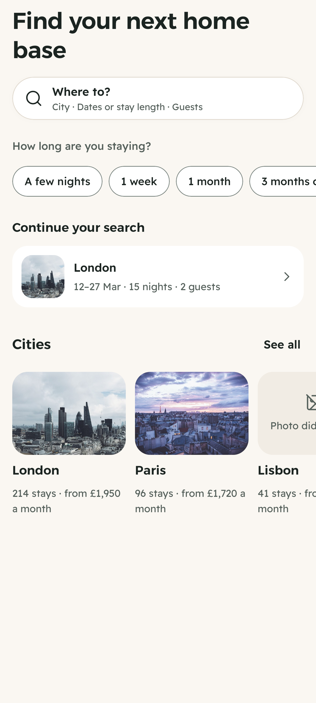 | 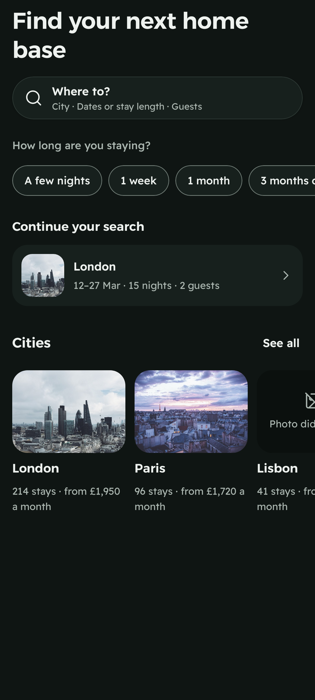 | 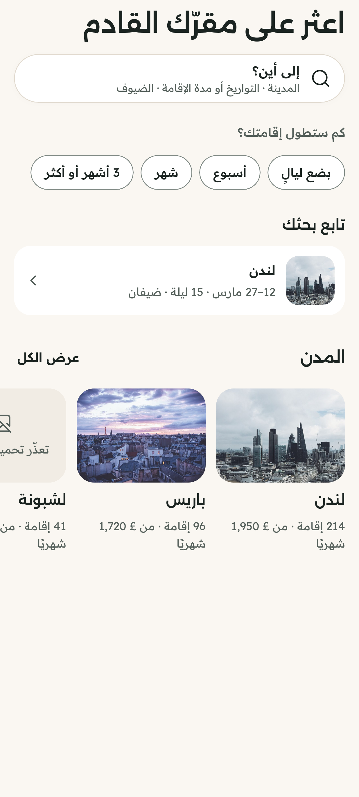 | 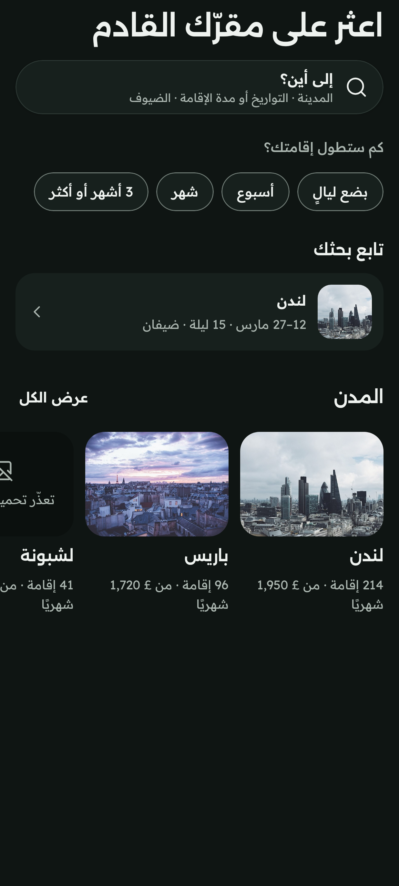 |
| Results | 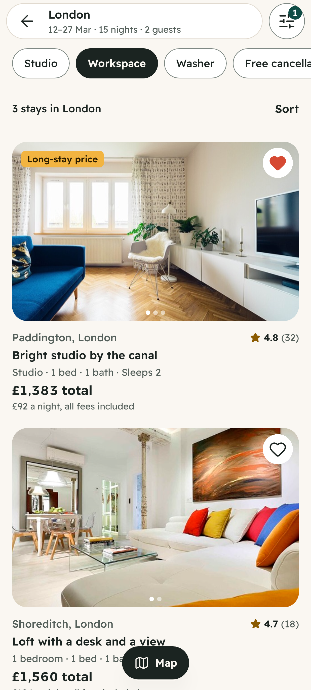 | 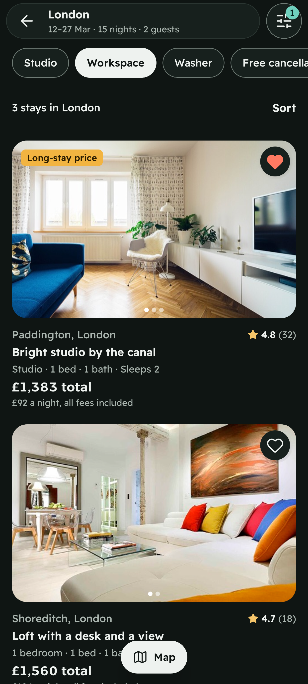 | 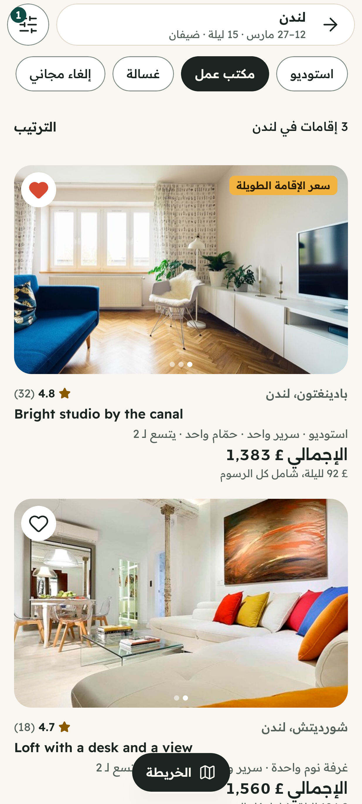 | 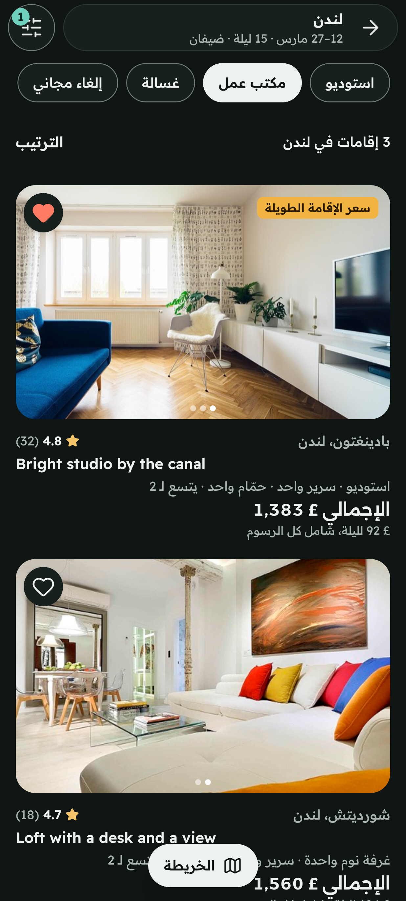 |
| Details | 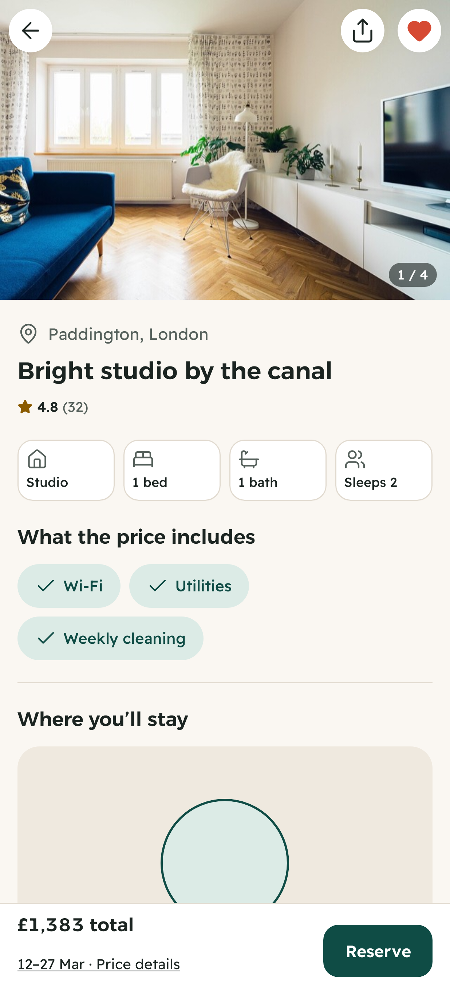 | 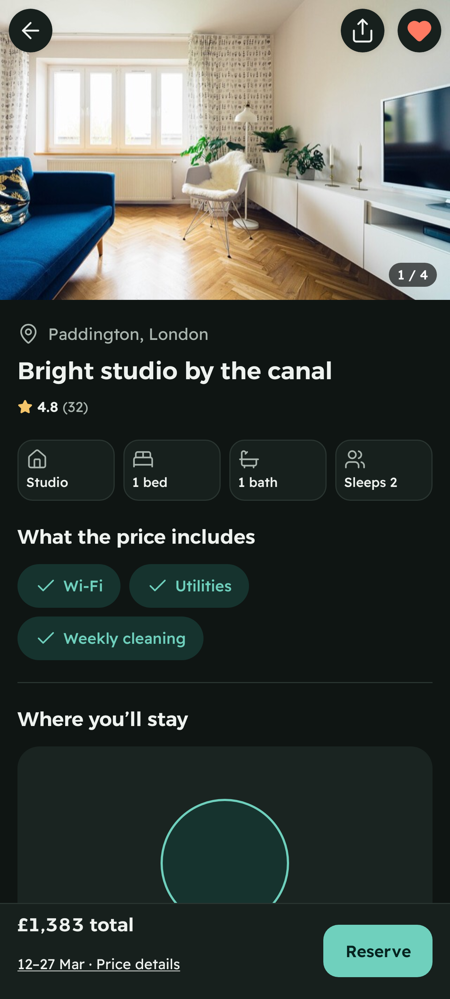 | 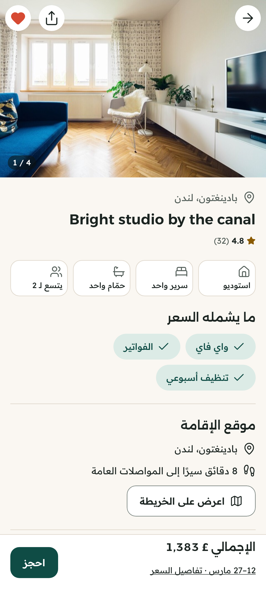 | 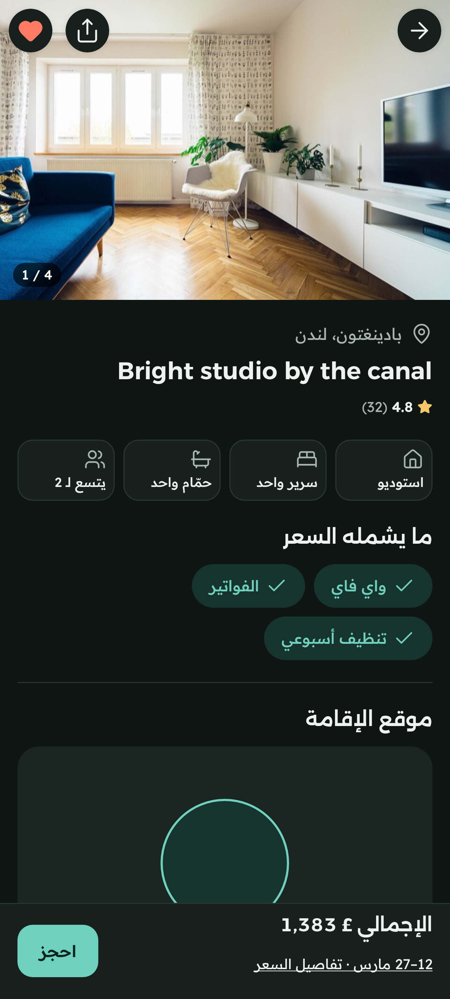 |
| Map | 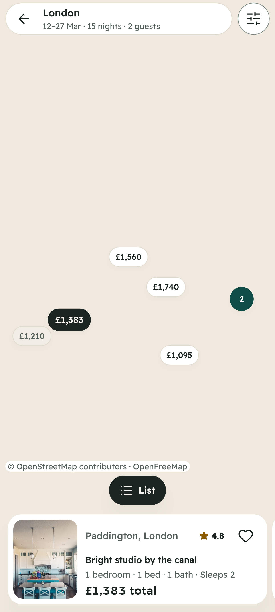 | 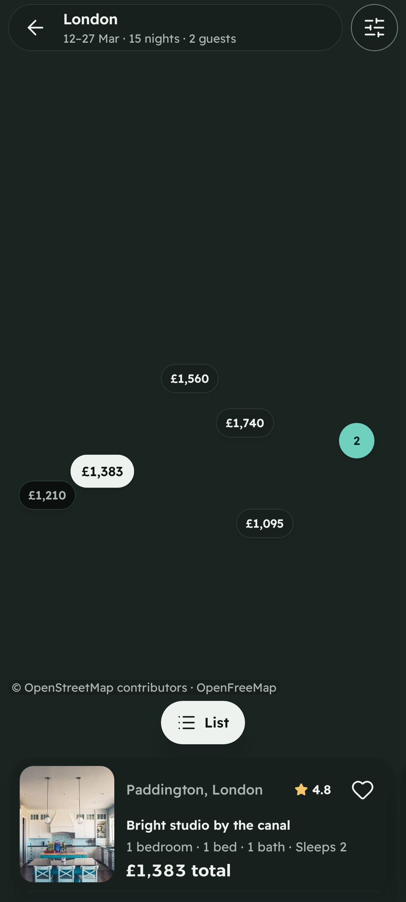 | 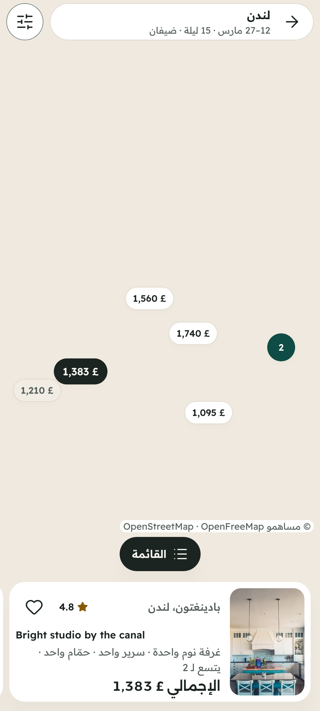 | 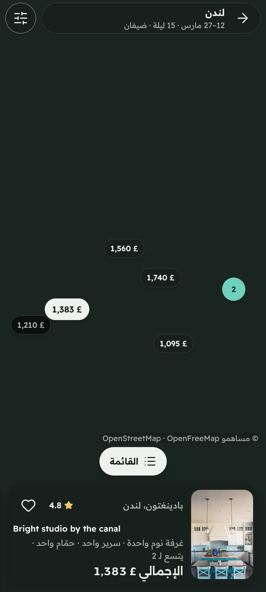 |
| Checkout | 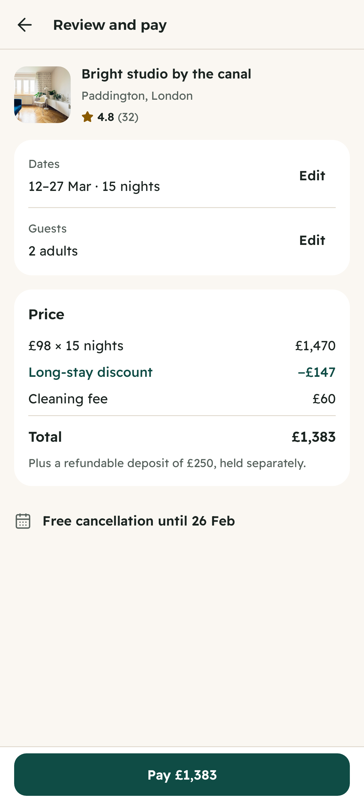 | 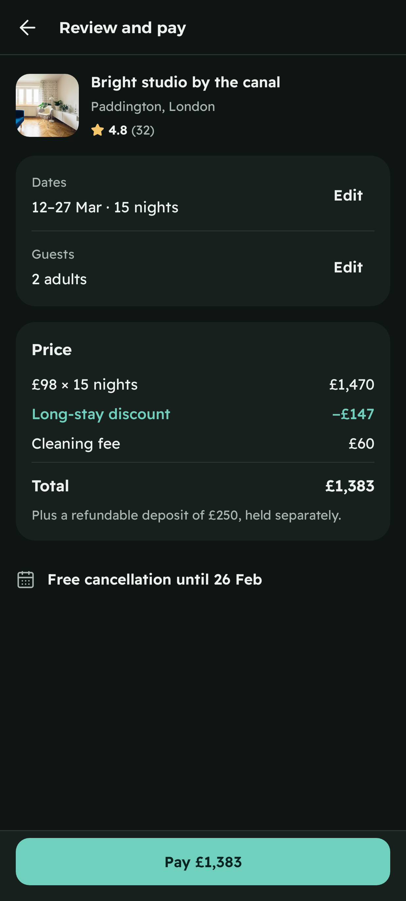 | 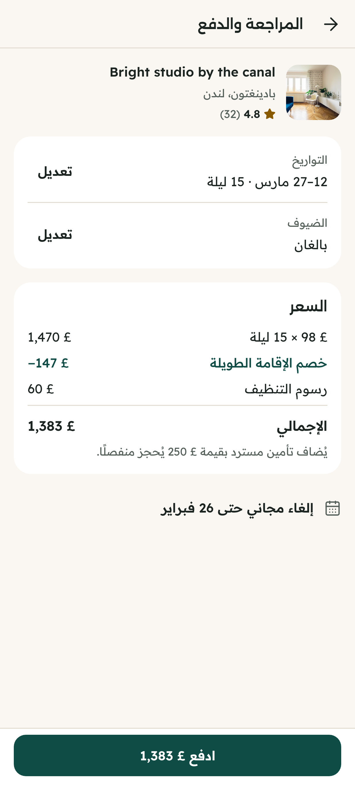 | 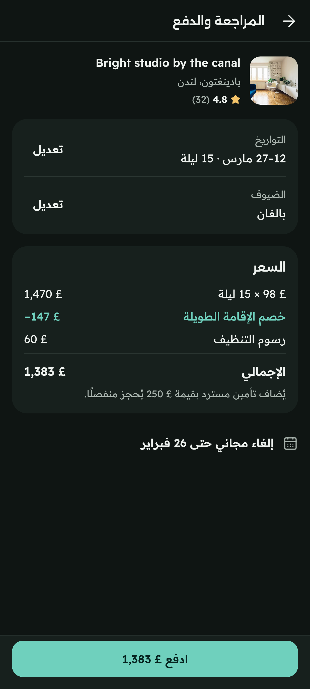 |

More: the [showcase gallery](docs/showcase/index.md) has every component in every variant and a recording per feature.

## How it is built

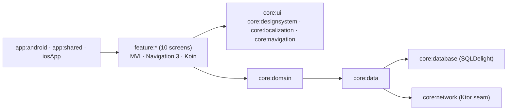

| | |
|---|---|
| **Platform** | Kotlin 2.4 · Compose Multiplatform 1.12 · AGP 9.5 · Gradle 9.5 · convention plugins |
| **Architecture** | `core/*` + `feature/*` modules · MVI / unidirectional data flow · Navigation 3 · Koin 4 |
| **Data** | SQLDelight 2.4, offline-first · Ktor 3.6 seam · kotlinx.serialization · Coil 3 |
| **Design system** | tokens generated from `design/tokens.json` → `SojournTheme`; Material 3 confined to one module |
| **Localization** | `AppLocale` single source · six Arabic plural forms · bidi-safe formatters · RTL by construction |
| **Quality gates** | detekt + Compose rules + custom standards rules · Konsist architecture tests · Roborazzi screenshot matrix · Compose UI tests · Maestro E2E · dependency-analysis |
| **Delivery** | GitHub Actions: PR · main (incl. iOS on macOS) · release (signed builds) · docs · Conventional Commits · release-please |
| **Docs** | MkDocs Material + Dokka on GitHub Pages · 14 ADRs · guides that double as agent playbooks |

Every "never" in the docs is a rule a tool enforces: raw `dp`/`sp`/colours in a feature, a Material import outside the design system, a left/right modifier, a string literal in UI, a price that is not a `PriceDisplay` — each fails the build. [Architecture overview →](docs/architecture/overview.md)

## Built AI-first

This repository is designed to be worked on by humans **and** coding agents, with the human as architect and reviewer:

- **An agent contract** — [`CLAUDE.md`](CLAUDE.md) encodes the module rules, patterns, commands and documentation duties, so an agent works *inside* the architecture.
- **Version-exact documentation on tap** — `.mcp.json` connects agents to [Context7](https://context7.com) for the pinned library versions and to GitHub for issues and PRs, so implementation follows the docs, not memory.
- **Automated PR review** — every pull request is reviewed against the ADRs and `CLAUDE.md` by the Claude Code GitHub Action before a human looks at it.
- **Automated release notes and docs sync** — release-please cuts versions and changelogs from Conventional Commits; documentation drift is flagged on the PR.
- **Human in the loop, always** — nothing reaches `main` except through a pull request a human merges; agent contributions carry `Co-Authored-By` trailers.

How it was decided, and what was deliberately *not* automated: [ADR 0013](docs/adr/0013-ai-agents-dev-loop.md).

## Status

| Phase | | |
|---|---|---|
| 0 | Repository & documentation foundation | 🟡 in progress |
| 1 | Build system & quality gates | ⚪ |
| 2 | Core foundations (tokens, theme, localization, navigation) | ⚪ |
| 3 | Design system — 26 components × 4 variants | ⚪ |
| 4 | Data — SQLDelight, repositories, pricing invariants | ⚪ |
| 5 | Screens — 10 features | ⚪ |
| 6 | Platform polish & end-to-end | ⚪ |
| 7 | Release v0.1.0 | ⚪ |

[Plan with exit criteria →](docs/plan.md)

## Run it

```bash
./gradlew :app:android:installDebug       # Android (device or emulator)
./gradlew check                           # everything CI runs on a PR
open iosApp/iosApp.xcodeproj              # iOS — requires Xcode
```

Setup, troubleshooting and AI tooling: [docs/guides/local-setup.md](docs/guides/local-setup.md).

## Repository map

```
app/            android (Activity shell) · shared (umbrella KMP module → iOS framework)
iosApp/         Xcode project hosting the shared framework
core/           model · common · localization · designsystem · ui · navigation · platform
                database · network · data · domain · testing
feature/        explore · search · results · filters · details · checkout · map · saved · bookings · profile
build-logic/    Gradle convention plugins
tooling/        konsist (architecture tests) · detekt-rules (design-system standards as lint)
design/         tokens.json — source of the generated theme · brand/ (wordmark, icon)
docs/           plan · architecture · ADRs · guides · design system · showcase
.maestro/       end-to-end flows
```

## Documentation

[Plan](docs/plan.md) · [Architecture](docs/architecture/overview.md) · [Modules](docs/architecture/modules.md) · [ADRs](docs/adr/README.md) · [Tech stack](docs/tech-stack.md) · [Design system → code](docs/design-system/mapping.md) · [Guides](docs/guides/local-setup.md) · [Contributing](CONTRIBUTING.md)

## About

Built by [Mohammad Abu Lubad](https://github.com/Besoabulubbad) as a public showcase of AI-first mobile engineering. The product and brand are fictional; the techniques are not. Licensed under [MIT](LICENSE).
