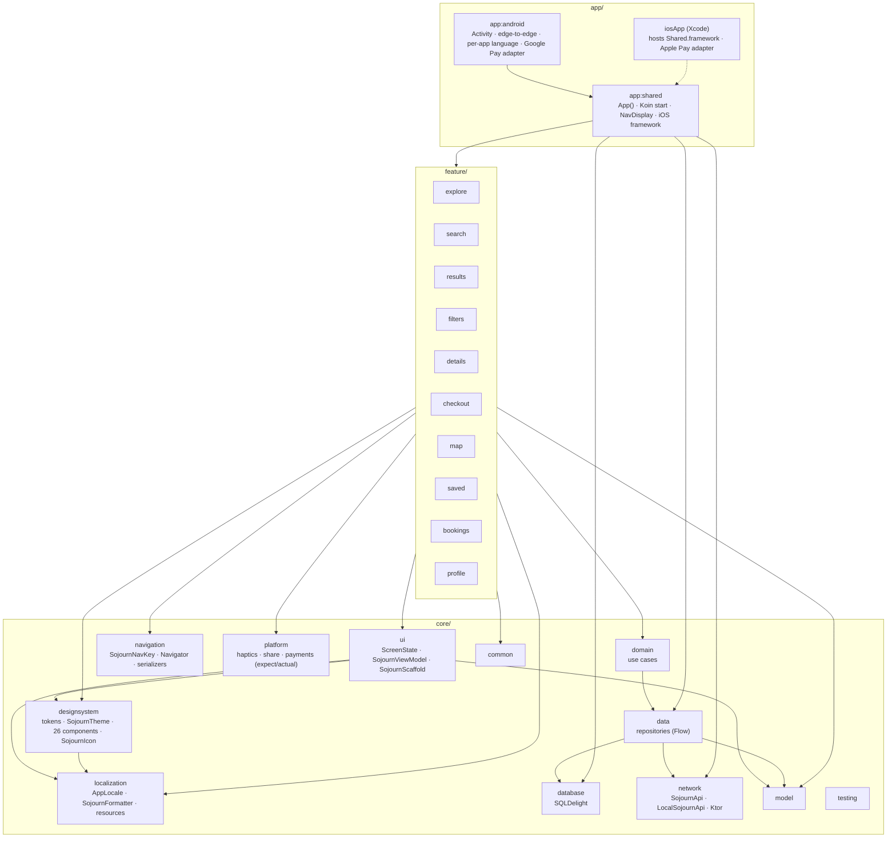

# Architecture overview

One Kotlin Multiplatform codebase. Shared Compose Multiplatform UI. Modules split by **layer** (`core/*`) and by **screen** (`feature/*`), with two thin application shells. Every rule below is enforced by a tool named in [Enforcement](#enforcement).

## Shape



Arrows mean "may depend on". Anything not drawn is forbidden. Two consequences matter most:

- **Features never see data infrastructure.** They call use cases from `core:domain`; `app:shared` binds repositories. A feature cannot accidentally query the database or the network.
- **Material lives in one place.** Only `core:designsystem` depends on Material 3. Features compose `Sojourn*` components, so the design system is the only path to pixels.

## Layers

### Presentation — MVI / unidirectional data flow

Every screen has exactly one `SojournViewModel<State, Intent, Effect>`:

```kotlin
abstract class SojournViewModel<S : UiState, I : UiIntent, E : UiEffect>(initial: S) : ViewModel() {
    val state: StateFlow<S>              // one immutable snapshot of the screen
    val effects: Flow<E>                 // one-off: navigate, snackbar, haptic
    fun onIntent(intent: I)              // the only entry point from the UI
    protected fun setState(reduce: S.() -> S)
    protected fun sendEffect(effect: E)
}
```

Each feature exposes two composables:

- `XxxRoute(...)` — stateful. Obtains the ViewModel from Koin, collects `state`, handles `effects` (navigation via `Navigator`, snackbars via `SojournScaffold`), and calls `XxxScreen`.
- `XxxScreen(state: XxxUiState, onIntent: (XxxIntent) -> Unit)` — stateless. This is what previews, screenshot tests and UI tests render.

Data-bearing screens model `ScreenState<T>` (`Loading`, `Content(data)`, `Empty`, `Error(cause)`, `Offline(cached?)`) inside their `UiState`; `when` over it is exhaustive, so a missing state does not compile.

Why MVI: the state is a value, so a test is "given state and intent, expect state"; screenshot tests are one state each; every screen reads the same way. See [ADR 0006](../adr/0006-mvi-presentation.md).

### Navigation — Navigation 3

The back stack is plain state owned by the app, not hidden in a controller.

- `core:navigation` defines `@Serializable sealed interface SojournNavKey : NavKey` and one key per destination (`ExploreKey`, `StayDetailsKey(stayId, quoteId?)`, `CheckoutKey(quoteId)`, …). It also assembles the `SerializersModule` with explicit `polymorphic(NavKey::class)` registration — required on iOS, where the reflection-based overload is unavailable.
- Each feature contributes `fun EntryProviderBuilder<NavKey>.exploreEntries(navigator: Navigator)`; `app:shared` composes them into one `entryProvider` and the `NavDisplay`.
- Four top-level tabs (Explore, Saved, Bookings, Profile) keep **separate back stacks**, persisted across configuration change and process death via `rememberNavBackStack` with the saved-state configuration.
- Scenes: `SojournSheet` destinations (Filters, price breakdown) use a bottom-sheet scene strategy; dialogs use the dialog scene. Transitions use `SojournMotion` and mirror in RTL.
- ViewModels are scoped to their `NavEntry` through `lifecycle-viewmodel-navigation3` and Koin's `koin-compose-navigation3` integration.

The `Navigator` interface (`goTo(key)`, `back()`, `switchTab(tab)`, `popTo(key)`) is what features call; its implementation in `app:shared` mutates the back stacks. See [ADR 0005](../adr/0005-navigation-3.md).

### Dependency injection — Koin

One Koin module per Gradle module, named after it (`exploreModule`, `dataModule`). `app:shared` starts Koin with all modules; `app:android` and `iosApp` call `initKoin()` from their entry points. ViewModels are declared with `viewModelOf(::ExploreViewModel)` and obtained in `Route` composables with `koinViewModel()`. A `checkModules()` test in `app:shared` fails the build if the graph has a hole. See [ADR 0004](../adr/0004-dependency-injection-koin.md).

### Domain and data

- `core:domain` holds **use cases**: small classes with one `operator fun invoke`, pure Kotlin, depending only on repository interfaces and `core:model`. Business rules that the engineering standards name — "ratings hidden under 3 reviews", "breakdown lines sum to the total", "no dates means a *from* price with exclusions" — live here, with tests.
- `core:data` implements repositories. **SQLDelight is the source of truth**: reads are `Flow`s from the database; a refresh pulls from `SojournApi` and writes to the database; the UI never waits on the network to show cached content. This is what makes the offline state a real state rather than a spinner.
- `core:network` owns the `SojournApi` seam. Today it is `LocalSojournApi` — bundled JSON behind simulated latency and injectable failure, so loading, error and offline states are reproducible in tests and demos. `KtorSojournApi` is configured and swappable without touching features. See [ADR 0007](../adr/0007-offline-first-sqldelight.md).

### Design system

`design/tokens.json` is copied verbatim from the design-system artifact. A Gradle task in `build-logic` (`sojourn.tokens`) generates Kotlin objects into `core:designsystem` at build time — `SojournColors` (light and dark schemes), `SojournType` (Alexandria display styles, Readex Pro text styles), `SojournSpacing`, `SojournShapes`, `SojournMotion`, `SojournSizes` — so a token change is a JSON diff and a regenerated file, never a hand edit. A test computes contrast for every text pair the tokens' usage notes name, in both themes.

`SojournTheme { }` provides them through composition locals and sets `LayoutDirection` from `AppLocale`. Components are `Sojourn`-prefixed and map one-to-one to design-system cards; see [the mapping](../design-system/mapping.md). See [ADR 0008](../adr/0008-design-tokens-generated.md).

### Localization

`AppLocale` in `core:localization` is the single source for language (`en-GB`, `ar`). It drives string resources, plural selection, layout direction, digits, dates and money through `SojournFormatter`, which wraps inserted values in bidi isolates. Nothing outside this module reads the device locale. Host-written text renders through `HostText` in its own language and direction. See [ADR 0009](../adr/0009-localization-applocale.md).

### Platform adapters

`core:platform` declares `expect` interfaces for haptics, the share sheet, opening a location in Maps, the payment sheet (Google Pay / Apple Pay, stubbed) and the reduce-motion setting; `androidMain`/`iosMain` provide `actual`s. Features depend on the interfaces only.

### Application shells

- `app:shared` — the umbrella multiplatform module: `App()` root composable (theme, locale, Koin, `NavDisplay`), `MainViewController()` for iOS, and the `Shared.framework` binary. It is the only module that depends on everything.
- `app:android` — one `Activity`, `enableEdgeToEdge()`, splash, predictive back, per-app language via `LocaleManager`, Google Pay adapter.
- `iosApp` — Xcode project hosting the framework in a `UIViewControllerRepresentable`, safe areas, Apple Pay adapter.

## Cross-cutting rules and where they come from

The design system's [engineering standards](../design-system/mapping.md#engineering-standards) define rules L-01…M-04. The table maps each family to the mechanism here.

| Standard | Mechanism |
|---|---|
| L-01…L-06 locale and direction | `AppLocale`; Konsist forbids platform locale APIs outside `core:localization`; detekt forbids left/right/absolute modifiers in features; `SojournIcon` is sealed with an `autoMirror` flag |
| S-01…S-08 strings | detekt forbids string literals and templates reaching text parameters; plural-forms CI check; `SojournFormatter` isolates; `HostText` |
| P-01…P-06 price | `PriceDisplay` type; `SojournPrice` is the only price renderer; quote id travels in `StayDetailsKey`/`CheckoutKey`; pricing tests in `core:domain` |
| I-01…I-05 insets and states | `SojournScaffold` owns insets; detekt forbids inset modifiers in features; `ScreenState<T>` sealed |
| C-01…C-06 colour, contrast, touch | generated tokens; contrast test; 48dp built into components; `contentDescription` is a required parameter on `SojournIconButton`; screenshot matrix in both themes |
| M-01…M-04 motion | `SojournMotion` tokens; detekt forbids literal durations in features; `reduced` flag honoured by transition helpers |

## Enforcement

| Rule | Tool | Where |
|---|---|---|
| Module dependency graph above | Konsist | `tooling/konsist` |
| No Material imports outside `core:designsystem` | Konsist | `tooling/konsist` |
| No raw `Color`/hex/`dp`/`sp`/ms literals in `feature:*`, `core:ui` | detekt custom rule set | `build-logic` + `config/detekt` |
| No `left`/`right`/`absoluteOffset`/`scaleX(-1)` in features | detekt | `config/detekt` |
| No user-facing string literals; no templates into text | detekt | `config/detekt` |
| No inset modifiers in features | detekt | `config/detekt` |
| Naming (`XxxViewModel`, `XxxUiState`, `Sojourn*`) | Konsist | `tooling/konsist` |
| Arabic plurals complete | Gradle verification task | `core:localization` |
| Token contrast | unit test | `core:designsystem` |
| Koin graph complete | `checkModules()` | `app:shared` |
| Pricing invariants | unit tests | `core:domain` |
| Visual regressions, 4 variants × font scale × width | Roborazzi | each module's `androidHostTest` |
| Dependency hygiene | dependency-analysis `buildHealth` | root |
| Everything above, on every PR | GitHub Actions | `.github/workflows/pr.yml` |

## Reading order for a new engineer

1. This page. 2. [Modules](modules.md). 3. [ADR index](../adr/README.md), then the ADR for whatever you are about to touch. 4. The guide for your task in `guides/`. 5. The design-system card for the component or screen, via [the mapping](../design-system/mapping.md).
